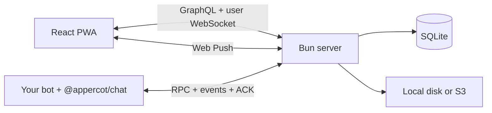

<div align="center">


# Appercot

**An independent home for bots and conversations.**

A self-hosted bot messenger and installable PWA. Run the server on your own hardware,
own the data and bot accounts, and build integrations with a TypeScript SDK.
No messenger platform or Appercot subscription sits between you and your deployment.

[](https://bun.sh)
[](https://www.typescriptlang.org/)
[](https://react.dev/)
[](https://orm.drizzle.team/)
[](https://docs.docker.com/compose/)
[](docs/guide/ai/context7.md)

[Install](#install-in-five-minutes) · [Why Appercot](#why-appercot) · [Documentation](docs/guide/index.md) · [Architecture](#how-it-works) · [AI setup](docs/guide/ai/context7.md)

</div>

---

## Why Appercot

**The primary goal is an independent service.** Telegram is a hosted messenger with a global network; Appercot is a service you operate yourself. That makes it a better fit when ownership of the platform, data, and bot runtime is the requirement.

|                                                         | Telegram |                **Appercot**                |
| ------------------------------------------------------- | :------: | :----------------------------------------: |
| You operate the service                                 |    No    |                  **Yes**                   |
| Accounts, conversations, and files stay in your storage |    No    |                  **Yes**                   |
| Bot tokens come from your own server                    |    No    |                  **Yes**                   |
| Server behavior and upgrade timing are yours to control |    No    |                  **Yes**                   |
| Backup, retention, and deletion policies are yours      | Limited  |                  **Yes**                   |
| Existing global user network and mature native clients  | **Yes**  |                     No                     |
| Subscription charged by Appercot                        |   None   | **None — you pay for your infrastructure** |

Telegram remains the better choice when immediate reach and managed delivery matter most. Appercot is for private communities, products, and integrations that must not depend on another messenger's accounts, API policy, or availability decisions.

Read the full [independence rationale and trade-offs](docs/guide/concepts/independence.md).

## What you get

**In the browser.** An installable React PWA with shared chats, a bot catalog, invitations, roles, message history, keyboards, Markdown, media, and Web Push. Desktop and mobile layouts use the same server and account model.

**For bot developers.** `@appercot/chat` provides typed RPC, automatic reconnects, durable event acknowledgement, commands, callbacks, shortcuts, per-chat JSON storage, validated multi-step flows, and file uploads.

```ts
import { createBot } from '@appercot/chat'

const bot = createBot({
  url: process.env.BOT_URL ?? 'ws://localhost:3000/api/bot/ws',
  token: process.env.BOT_TOKEN!,
})

const start = bot.command('start', 'Start', (context) => context.reply('Ready')).roles('all')

bot.on('chat_started', (context) => context.replyWithCommand(start, 'Use %s to begin.'))

await bot.start({ commands: [start] })
```

**For integration tests.** `@appercot/test` starts the real GraphQL, WebSocket, SQLite, media, and SPA stack. Its `AppercotTestClient` works with Bun, Vitest, Jest, and Playwright without a mock server or runner-specific client.

**For operators.** One Bun application, SQLite, local disk or S3-compatible media through Garage, a configurable host port for an existing reverse proxy, and documented backup and recovery.

## Install in five minutes

You need Docker with Compose and OpenSSL. Clone this repository and enter its directory, then:

```bash
cp .env.example .env
# Generate ADMIN_PASSWORD, S3_SECRET_ACCESS_KEY, and GARAGE_RPC_SECRET as shown in the deployment guide.
docker compose pull
docker compose up -d
```

If the GHCR package is private, run `docker login ghcr.io` before pulling. Open `http://localhost:3000`, sign in as the initial owner, and create your first bot under **Settings → Bots**. When using a reverse proxy or public domain, set `PUBLIC_URL` to that external HTTP(S) origin in `.env` first.

```bash
docker compose ps
docker compose logs app garage
# Set a new APPERCOT_VERSION in .env before updating.
docker compose pull
docker compose up -d
```

See the [Docker deployment guide](docs/guide/deployment/docker.md) for DNS, credentials, volumes, and updates. For a standalone binary, see [local development and build](docs/guide/getting-started/local-development.md).

## Local development

Bun 1.4.3 is required:

```bash
cp .env.example .env
# Set ADMIN_PASSWORD in .env (minimum eight characters).
bun install --frozen-lockfile
bun run dev
```

The web client opens at `http://localhost:5173`; the API listens at `http://localhost:3000`. Run the included bot after copying a token from bot settings:

```bash
BOT_TOKEN='<botId>:<token>' \
BOT_URL='ws://localhost:3000/api/bot/ws' \
bun examples/echo-bot/index.ts
```

Continue with [your first bot](docs/guide/getting-started/first-bot.md), the [echo example](examples/echo-bot/index.ts), or the [wizard example](examples/wizard-bot/index.ts).

## How it works

The server, protocol, SDK, PWA, and test environment live in one repository so a deployment can be inspected and changed as a whole.



What that provides in practice:

- **Bot events are not removed before acknowledgement.** The server persists an outbox entry, the SDK handles events serially per chat, and `ackOnError: false` leaves failed events available for redelivery.
- **Repeated user sends are idempotent.** The same chat and client ID return the existing message rather than creating a duplicate.
- **Media is not public by default.** Original and byte-range requests authorize the caller against the owning chat.
- **Tests exercise real behavior.** Reset revokes affected sessions and sockets, restores baseline fixtures, and preserves global sequence monotonicity.

See [architecture](docs/guide/concepts/architecture.md), [security](docs/guide/concepts/security.md), and [bot lifecycle](docs/guide/bots/connection.md).

## Tests

```bash
bun test              # unit and integration tests
bun run test:garage   # disk and Garage media tests with Docker
bun run check         # docs, lint, layers, GraphQL, types, and tests
bun run build         # production SPA and standalone server
```

Build the SPA and start the real test environment in a separate process:

```bash
bun run --filter '@appercot/web' build
export ADMIN_PASSWORD='test-admin-password'
export ALICE_PASSWORD='test-alice-password'
export ECHO_BOT_TOKEN='bot-echo:test-secret'
export BOT_APPERCOT_TEST_TOKEN='test-control-token'
bun --no-env-file packages/test/src/cli.ts --config examples/appercot.test.json
```

The CLI prints `{"endpoint":"http://127.0.0.1:…"}` to stdout. Pass that endpoint and the control token to a runner:

```ts
import { AppercotTestClient } from '@appercot/test'

const appercot = new AppercotTestClient({
  endpoint: process.env.BOT_APPERCOT_TEST_ENDPOINT!,
  token: process.env.BOT_APPERCOT_TEST_TOKEN!,
})

beforeAll(() => appercot.ready())
beforeEach(() => appercot.flushState())
afterAll(() => bot.stop())
```

Run all included compatibility scenarios, including the headless browser matrix:

```bash
bun packages/test/node_modules/@playwright/test/cli.js install chromium firefox webkit
bun packages/test/scripts/run-compatibility.ts --with-browser
```

For browser-only iteration, use `bun run --filter '@appercot/test' test:browser -- --project=desktop-chromium`; omit `--project` to run desktop/mobile Chromium, Firefox, and WebKit. See [browser testing](docs/guide/testing/browser.md) for WCAG scans and manual device limits.

The control API is enabled only by the test CLI. Never expose it or its token in production. Full fixture and cleanup semantics are in the [testing guide](docs/guide/testing/index.md).

## Development

```text
apps/server          Bun, GraphQL, domain, WebSockets, SQLite, media
apps/web             React PWA and Feature-Sliced frontend
packages/protocol    Shared Zod wire schemas
packages/chat        Bot SDK
packages/test        Real test environment and runner-agnostic client
examples             Runnable echo and wizard bots
docs/guide           Current English user and developer documentation
.agents              Source-level invariants and troubleshooting
```

Start with [project structure](docs/guide/development/project-structure.md) and [verification workflow](docs/guide/development/workflow.md). Coding agents and maintainers must also read [AGENTS.md](AGENTS.md) before changing code.

## Documentation and AI

The [documentation index](docs/guide/index.md) divides current instructions into small pages for setup, bot development, testing, deployment, operations, and contributions.

Appercot includes [`context7.json`](context7.json) so [Context7](https://context7.com) can index the public English guide and provide it to coding assistants. After a maintainer submits the public repository, use the exact library ID shown by Context7:

```text
Create an Appercot bot with a command, a flow, and a Vitest integration test.
Use library /OWNER/appercot.
```

Replace `OWNER` with the real repository owner; adding the configuration file alone does not register the library. See [Context7 setup](docs/guide/ai/context7.md) and [effective prompts](docs/guide/ai/prompting.md).

## Current scope and roadmap

- [x] Self-hosted accounts, bot catalog, chats, roles, invitations, and Web Push
- [x] Commands, callbacks, layout-independent shortcuts, and multi-step flows
- [x] Local and S3-compatible media with access-controlled delivery
- [x] Real test server with fixtures and Bun, Vitest, Jest, and Playwright scenarios
- [ ] Web applications inside the bot shell
- [x] Durable browser drafts and text outbox across reloads
- [ ] Bounded synchronization catch-up and broader interactive browser coverage
- [ ] Crash-injection coverage across message, update, and outbox commit boundaries

The detailed technical gaps are tracked in [open gaps](.agents/todo.md). Current documentation does not claim end-to-end encryption or multi-node active-active SQLite deployment.

---

<div align="center">

Appercot is self-hosted and built on the assumption that you run the service yourself.

**Own the server. Own the bots. Own the data.**

[Start with the guide](docs/guide/index.md) · [Deploy with Docker](docs/guide/deployment/docker.md) · [Build a bot](docs/guide/bots/index.md)

</div>
