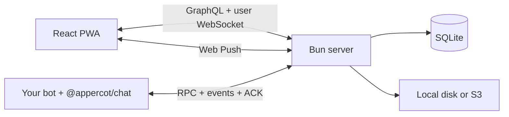

# Architecture

One Bun process serves the application API and built PWA. During development, Vite serves the web client separately.

## Repository components

| Component           | Responsibility                                                                   |
| ------------------- | -------------------------------------------------------------------------------- |
| `apps/server`       | HTTP, GraphQL, WebSockets, domain operations, SQLite migrations, media, and push |
| `apps/web`          | React PWA, navigation, chat state, synchronization, settings, and command UI     |
| `packages/protocol` | Shared Zod schemas and inferred wire types                                       |
| `packages/chat`     | Bot connection, RPC, contexts, commands, flows, storage, and uploads             |
| `packages/test`     | Standalone test CLI and runner-agnostic control client                           |
| `examples`          | Runnable echo and wizard bots                                                    |

## Delivery model

- GraphQL session reads require the browser's session cookie.
- User updates are persisted and delivered through the user WebSocket hub.
- Bot events enter a durable outbox before delivery and remain there until acknowledged.
- Event handling and storage updates are serialized per chat; different chats can proceed independently.
- Repeating a user send with the same chat and client ID returns the existing message instead of creating a duplicate.
- File reads authorize the caller against the chat that owns the file.

## State ownership

SQLite is the system of record for accounts, chats, messages, synchronization updates, bot outbox entries, and file metadata. Binary attachments live on local disk or in S3-compatible storage. A consistent backup therefore needs both database and media state.

The current design is a single self-hosted service, not a distributed SQLite cluster. Run independent test suites against separate endpoints and data directories.

Next: [security model](security.md) or [why independence matters](independence.md).
